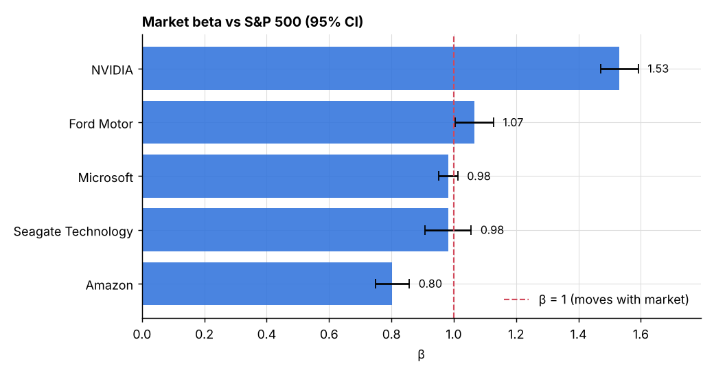
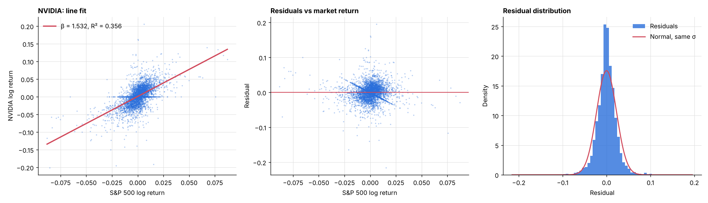

# CAPM Beta Analysis: Five US Stocks vs the S&P 500

Estimates the market beta of **Amazon, Seagate, Ford, NVIDIA and Microsoft** against the
S&P 500 using 18 years of daily data (Oct 2008 – Oct 2026, 4,532 trading days), and
runs formal hypothesis tests on each coefficient.

The project began as an Excel workbook built with the Data Analysis ToolPak. This repo
rebuilds it in Python with OLS written from scratch in NumPy, and tests that check the
output against the original Excel figures to 9 significant digits.



## Method

For each stock, daily log returns are regressed on S&P 500 log returns (the single-index model):

$$ r_{i,t} = \alpha_i + \beta_i \, r_{m,t} + \varepsilon_{i,t}, \qquad r_t = \ln P_t - \ln P_{t-1} $$

- **β** measures sensitivity to the market: β > 1 means the stock amplifies market moves, β < 1 means it dampens them.
- **α** (Jensen's alpha) is the average daily return not explained by market exposure.

For each regression the code produces the same output as Excel's regression tool: R, R², adjusted R²,
standard error, the ANOVA table with its F-test, and coefficients with standard errors, t-statistics,
p-values and 95% confidence intervals. It then runs **nine t-tests per stock** at α = 0.05:

| Null hypothesis | Two-sided | Left-tailed | Right-tailed |
|---|---|---|---|
| β = 1 (moves with the market) | β ≠ 1 | β < 1 | β > 1 |
| β = 0 (unrelated to the market) | β ≠ 0 | β < 0 | β > 0 |
| α = 0 (no abnormal return) | α ≠ 0 | α < 0 | α > 0 |

## Results

| Stock | β | 95% CI | Daily α | R² | Verdict |
|---|---|---|---|---|---|
| NVIDIA | **1.532** | [1.472, 1.592] | 0.00086* | 0.356 | Aggressive (β > 1), significant positive alpha |
| Ford | 1.066 | [1.005, 1.127] | −0.00027 | 0.206 | Slightly aggressive (β > 1) |
| Microsoft | 0.982 | [0.952, 1.012] | 0.00025 | **0.472** | Moves with the market (β = 1 not rejected) |
| Seagate | 0.981 | [0.907, 1.055] | 0.00051 | 0.130 | Moves with the market (β = 1 not rejected) |
| Amazon | **0.803** | [0.749, 0.857] | 0.00060* | 0.157 | Defensive (β < 1), borderline-significant alpha |

\* significant at 5% (two-sided). Amazon's p-value is 0.04999, right at the threshold.

**Key takeaways**
- NVIDIA is the only stock with a β clearly above 1: on average a 1% market move came with a ~1.5% move in NVDA. It also earned a statistically significant positive alpha (≈ 0.086% per day, about 24% a year compounded) on top of its market exposure.
- Amazon was less sensitive to the market than you might expect for a mega-cap tech stock.
- Microsoft has the highest R²: almost half its daily variance comes from the market, which fits its large weight in the S&P 500.
- The R² values are low to moderate (13–47%), so most daily movement in a single stock comes from firm-specific risk. Diversification works by removing that part.

Full tables, all 45 hypothesis tests and diagnostic plots are in [`results/report.md`](results/report.md).



## Project structure

```
├── data/prices.csv              # Daily closing prices (date, AMZN, SPX, STX, F, NVDA, MSFT)
├── src/capm_beta/
│   ├── data.py                  # Loading and validating prices, log returns
│   ├── regression.py            # OLS from scratch: coefficients, SEs, ANOVA, CIs
│   ├── hypothesis.py            # One- and two-sided t-tests on α and β
│   ├── plots.py                 # Line fit, residual plot, residual histogram, beta chart
│   ├── report.py                # Runs the analysis and writes CSV and Markdown output
│   └── __main__.py              # CLI
├── tests/test_regression.py     # Checks against scipy.stats.linregress and the original Excel output
├── scripts/extract_from_excel.py
└── results/                     # Generated output (summary.csv, hypothesis_tests.csv, report.md, figures/)
```

## Usage

```bash
git clone https://github.com/<your-username>/capm-beta-analysis.git
cd capm-beta-analysis
python -m venv .venv && source .venv/bin/activate   # Windows: .venv\Scripts\activate
pip install -e ".[dev]"

capm-beta                         # or: python -m capm_beta
pytest                            # run the tests
```

Options: `--data path/to/prices.csv`, `--out results/`, `--alpha-level 0.01`. Any CSV with a
`date` column, an `SPX` column and further price columns works, so you can analyse other tickers too.

As a library:

```python
from capm_beta import load_prices, log_returns, ols, standard_tests

r = log_returns(load_prices("data/prices.csv"))
res = ols(r["NVDA"].to_numpy(), r["SPX"].to_numpy())
print(res.beta.estimate, res.beta.ci_low, res.beta.ci_high)
for t in standard_tests(res):
    print(t.hypotheses, f"p={t.p_value:.4f}", t.decision)
```

## Limitations

- **Price rounding.** Prices are split-adjusted and rounded to cents. NVIDIA traded at about $0.25 (adjusted) in 2008, so many small moves round to zero: 995 of its daily returns are exactly 0. This shows up as the horizontal line in its scatter plot and slightly biases its early-period beta downward.
- **Constant beta.** The model assumes β stays fixed over 18 years. A rolling-window estimate would show how it changed.
- **Excess returns.** Raw returns are used rather than returns in excess of the risk-free rate, the same choice as in the original workbook. With daily data the difference is small, but a strict CAPM test would subtract the T-bill rate.
- **Error assumptions.** The residuals have fat tails (see the histograms) and likely heteroskedasticity. Robust (HC/Newey-West) standard errors would be a natural extension.

## Tech

Python · NumPy · pandas · SciPy · Matplotlib · pytest

## License

MIT
