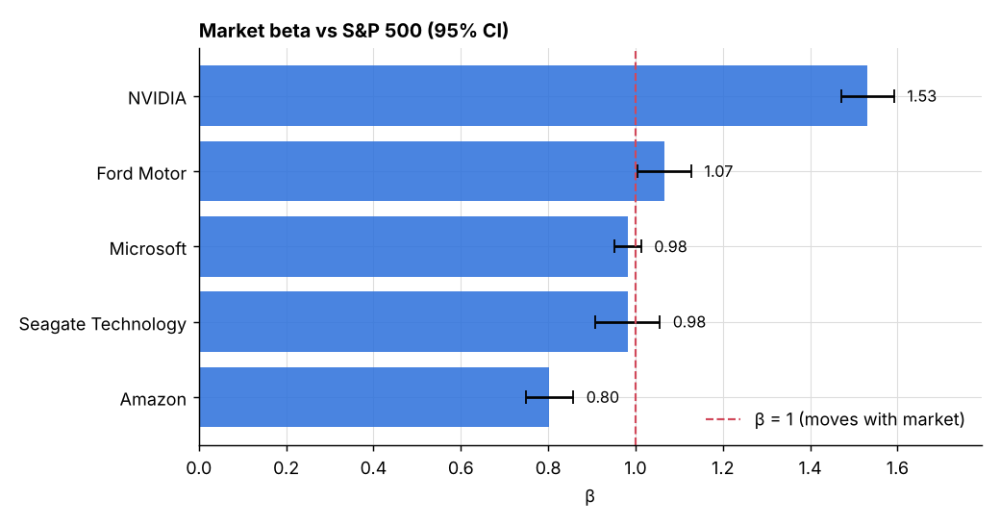
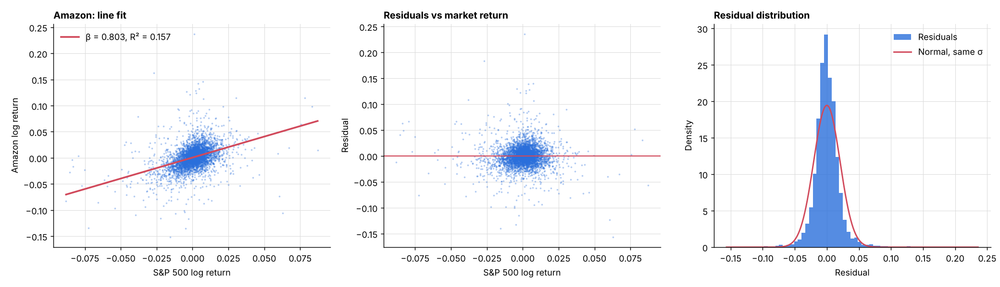
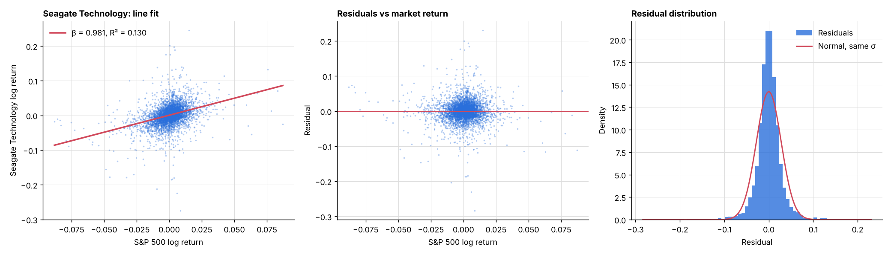
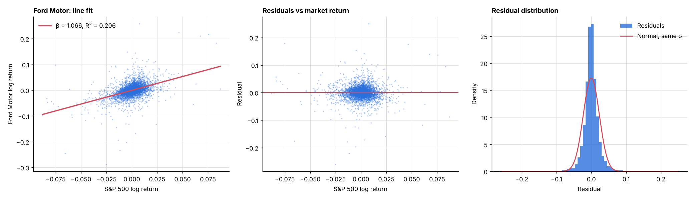
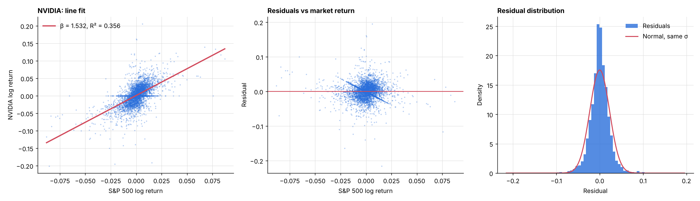
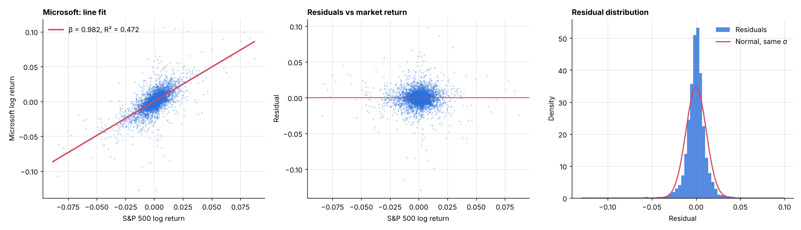

# CAPM beta analysis — results

Daily log returns, 2008-10-01 to 2026-10-07 (4532 observations per stock). Market proxy: S&P 500. Significance level: 0.05.

## Summary

| ticker | name | beta | beta_ci_low | beta_ci_high | alpha | alpha_p | r_squared |
|---|---|---|---|---|---|---|---|
| AMZN | Amazon | 0.803 | 0.749 | 0.857 | 0.00060 | 0.0500 | 0.157 |
| STX | Seagate Technology | 0.981 | 0.907 | 1.055 | 0.00051 | 0.2250 | 0.130 |
| F | Ford Motor | 1.066 | 1.005 | 1.127 | -0.00027 | 0.4317 | 0.206 |
| NVDA | NVIDIA | 1.532 | 1.472 | 1.592 | 0.00086 | 0.0114 | 0.356 |
| MSFT | Microsoft | 0.982 | 0.952 | 1.012 | 0.00025 | 0.1494 | 0.472 |

## Interpretation

- **Amazon (AMZN)** — β = 0.803 [0.749, 0.857]: **less volatile** than the market (β < 1); a significant daily alpha of 0.00060. The market explains 16% of daily variance.
- **Seagate Technology (STX)** — β = 0.981 [0.907, 1.055]: statistically indistinguishable from the market (β = 1 not rejected); no significant abnormal return (α = 0 not rejected). The market explains 13% of daily variance.
- **Ford Motor (F)** — β = 1.066 [1.005, 1.127]: **more volatile** than the market (β > 1); no significant abnormal return (α = 0 not rejected). The market explains 21% of daily variance.
- **NVIDIA (NVDA)** — β = 1.532 [1.472, 1.592]: **more volatile** than the market (β > 1); a significant daily alpha of 0.00086. The market explains 36% of daily variance.
- **Microsoft (MSFT)** — β = 0.982 [0.952, 1.012]: statistically indistinguishable from the market (β = 1 not rejected); no significant abnormal return (α = 0 not rejected). The market explains 47% of daily variance.

## Hypothesis tests

| ticker | hypotheses | tail | t_stat | p_value | decision |
|---|---|---|---|---|---|
| AMZN | H0: β=1  H1: β≠1 | two-sided | -7.140 | 0.00000 | Reject H0 |
| AMZN | H0: β=0  H1: β≠0 | two-sided | 29.092 | 0.00000 | Reject H0 |
| AMZN | H0: α=0  H1: α≠0 | two-sided | 1.961 | 0.04999 | Reject H0 |
| AMZN | H0: β=1  H1: β<1 | less | -7.140 | 0.00000 | Reject H0 |
| AMZN | H0: β=0  H1: β<0 | less | 29.092 | 1.00000 | Fail to reject H0 |
| AMZN | H0: α=0  H1: α<0 | less | 1.961 | 0.97500 | Fail to reject H0 |
| AMZN | H0: β=1  H1: β>1 | greater | -7.140 | 1.00000 | Fail to reject H0 |
| AMZN | H0: β=0  H1: β>0 | greater | 29.092 | 0.00000 | Reject H0 |
| AMZN | H0: α=0  H1: α>0 | greater | 1.961 | 0.02500 | Reject H0 |
| STX | H0: β=1  H1: β≠1 | two-sided | -0.492 | 0.62276 | Fail to reject H0 |
| STX | H0: β=0  H1: β≠0 | two-sided | 26.002 | 0.00000 | Reject H0 |
| STX | H0: α=0  H1: α≠0 | two-sided | 1.214 | 0.22498 | Fail to reject H0 |
| STX | H0: β=1  H1: β<1 | less | -0.492 | 0.31138 | Fail to reject H0 |
| STX | H0: β=0  H1: β<0 | less | 26.002 | 1.00000 | Fail to reject H0 |
| STX | H0: α=0  H1: α<0 | less | 1.214 | 0.88751 | Fail to reject H0 |
| STX | H0: β=1  H1: β>1 | greater | -0.492 | 0.68862 | Fail to reject H0 |
| STX | H0: β=0  H1: β>0 | greater | 26.002 | 0.00000 | Reject H0 |
| STX | H0: α=0  H1: α>0 | greater | 1.214 | 0.11249 | Fail to reject H0 |
| F | H0: β=1  H1: β≠1 | two-sided | 2.132 | 0.03307 | Reject H0 |
| F | H0: β=0  H1: β≠0 | two-sided | 34.293 | 0.00000 | Reject H0 |
| F | H0: α=0  H1: α≠0 | two-sided | -0.786 | 0.43175 | Fail to reject H0 |
| F | H0: β=1  H1: β<1 | less | 2.132 | 0.98346 | Fail to reject H0 |
| F | H0: β=0  H1: β<0 | less | 34.293 | 1.00000 | Fail to reject H0 |
| F | H0: α=0  H1: α<0 | less | -0.786 | 0.21587 | Fail to reject H0 |
| F | H0: β=1  H1: β>1 | greater | 2.132 | 0.01654 | Reject H0 |
| F | H0: β=0  H1: β>0 | greater | 34.293 | 0.00000 | Reject H0 |
| F | H0: α=0  H1: α>0 | greater | -0.786 | 0.78413 | Fail to reject H0 |
| NVDA | H0: β=1  H1: β≠1 | two-sided | 17.389 | 0.00000 | Reject H0 |
| NVDA | H0: β=0  H1: β≠0 | two-sided | 50.093 | 0.00000 | Reject H0 |
| NVDA | H0: α=0  H1: α≠0 | two-sided | 2.533 | 0.01135 | Reject H0 |
| NVDA | H0: β=1  H1: β<1 | less | 17.389 | 1.00000 | Fail to reject H0 |
| NVDA | H0: β=0  H1: β<0 | less | 50.093 | 1.00000 | Fail to reject H0 |
| NVDA | H0: α=0  H1: α<0 | less | 2.533 | 0.99432 | Fail to reject H0 |
| NVDA | H0: β=1  H1: β>1 | greater | 17.389 | 0.00000 | Reject H0 |
| NVDA | H0: β=0  H1: β>0 | greater | 50.093 | 0.00000 | Reject H0 |
| NVDA | H0: α=0  H1: α>0 | greater | 2.533 | 0.00568 | Reject H0 |
| MSFT | H0: β=1  H1: β≠1 | two-sided | -1.154 | 0.24866 | Fail to reject H0 |
| MSFT | H0: β=0  H1: β≠0 | two-sided | 63.575 | 0.00000 | Reject H0 |
| MSFT | H0: α=0  H1: α≠0 | two-sided | 1.442 | 0.14935 | Fail to reject H0 |
| MSFT | H0: β=1  H1: β<1 | less | -1.154 | 0.12433 | Fail to reject H0 |
| MSFT | H0: β=0  H1: β<0 | less | 63.575 | 1.00000 | Fail to reject H0 |
| MSFT | H0: α=0  H1: α<0 | less | 1.442 | 0.92532 | Fail to reject H0 |
| MSFT | H0: β=1  H1: β>1 | greater | -1.154 | 0.87567 | Fail to reject H0 |
| MSFT | H0: β=0  H1: β>0 | greater | 63.575 | 0.00000 | Reject H0 |
| MSFT | H0: α=0  H1: α>0 | greater | 1.442 | 0.07468 | Fail to reject H0 |

## Diagnostics

### Amazon

### Seagate Technology

### Ford Motor

### NVIDIA

### Microsoft

